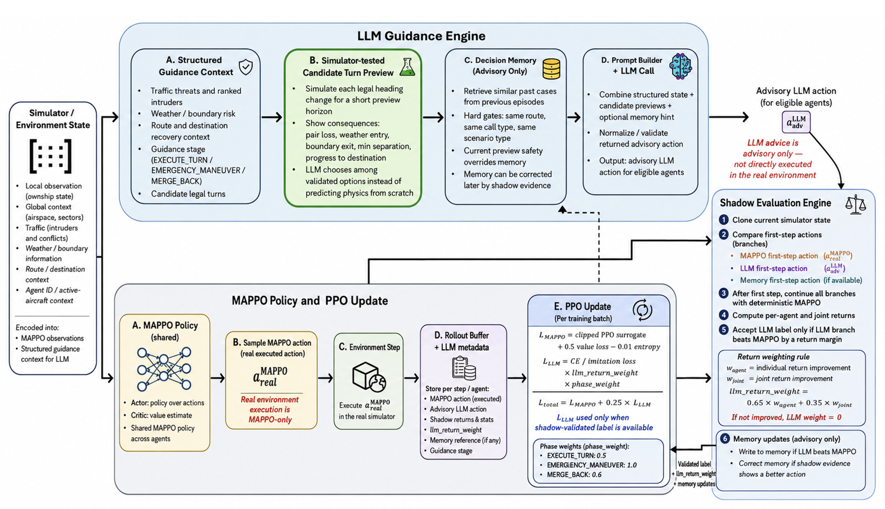

# LLM-Enhanced Multi-Agent Deep RL for Air-Traffic Sector Control

A research codebase for training a **multi-agent aircraft sector controller (MAPPO)** with
**Large Language Model (LLM) guidance that is validated before it is ever trusted**. An LLM
(or cheaper simulator heuristics) proposes advisory heading changes; those proposals are
checked by short *shadow* rollouts, and only validated, improvement-weighted signals are
mixed into the policy via an auxiliary loss. **The real environment is always driven by
MAPPO's own action — the LLM never flies the aircraft.**

> **Active development lives in [`multi-agent-isolated-llm-guidance/`](multi-agent-isolated-llm-guidance/).**
> This repository is a monorepo that also holds earlier experiment phases (see
> [Repository layout](#repository-layout)).

---

## Architecture



The system has three cooperating engines:

### 1. LLM Guidance Engine (advisory only)
Turns raw simulator state into a **validated** advisory action for eligible aircraft:
- **A. Structured Guidance Context** — traffic threats and ranked intruders, weather/boundary
  risk, route/destination recovery context, the guidance *stage*
  (`EXECUTE_TURN` / `EMERGENCY_MANEUVER` / `MERGE_BACK`), and the candidate legal turns.
- **B. Simulator-tested Candidate Turn Preview** — every legal heading change is simulated for
  a short horizon and its consequences recorded (pair loss, weather entry, boundary exit,
  min separation, progress to destination). **The LLM chooses among validated options instead
  of predicting physics from scratch** — the key anti-hallucination guardrail.
- **C. Decision Memory (advisory only)** — retrieves similar past cases under hard gates
  (same route, same call type, same scenario type); current preview safety always overrides
  memory; memories can be corrected later by shadow evidence.
- **D. Prompt Builder + LLM Call** — assembles state + previews + optional memory hint, calls
  the LLM (local Ollama model), and validates the returned advisory action.

### 2. MAPPO Policy & PPO Update (the only thing that acts)
- **A. Shared MAPPO policy** (decentralized actor, centralized agent-conditioned critic).
- **B. Sample MAPPO action** — `a_real^MAPPO`; **real environment execution is MAPPO-only**.
- **C. Environment step** — executes the MAPPO action in the real simulator.
- **D. Rollout buffer + LLM metadata** — stores the executed action plus the advisory action,
  shadow returns, `llm_return_weight`, memory reference, and guidance stage.
- **E. PPO update** — `L_total = L_MAPPO + 0.25 · L_LLM`, where the imitation term `L_LLM` is
  applied **only when a shadow-validated label exists** and is weighted by
  `llm_return_weight × phase_weight` (phase weights: `EXECUTE_TURN` 0.5,
  `EMERGENCY_MANEUVER` 1.0, `MERGE_BACK` 0.6).

### 3. Shadow Evaluation Engine (the isolation guarantee)
1. Clone the current simulator state.
2. Compare first-step actions across branches: MAPPO, LLM, and memory (if available).
3. After the first step, continue **all** branches with deterministic MAPPO.
4. Compute per-agent and joint returns.
5. **Accept the LLM label only if its branch beats MAPPO by a return margin** —
   `llm_return_weight = 0.65 · w_agent + 0.35 · w_joint`; if not improved, the weight is 0.
6. Memory updates (advisory only): write when the LLM beats MAPPO; correct when shadow
   evidence shows a better action.

---

## Two training directions

| Approach | Where | Idea |
|---|---|---|
| **Live LLM-guided MAPPO** (the diagram) | `multi-agent-isolated-llm-guidance/train.py` | Call the LLM during training; shadow-validate every advisory label before weighting the auxiliary loss. Strong isolation, but the live LLM is slow. |
| **Multi-teacher competence-weighted distillation** (current) | `multi-agent-isolated-llm-guidance/new_approach/` | Pre-record each guide's decisions, distill them into small **teacher networks** (an LLM teacher + cheap heuristic teachers `best_preview` / `preview_safe`), then distill the MAPPO student from **multiple complementary teachers at once**, trusting each where shadow evaluation says it is stronger. Removes the live LLM from training and tests the claim that *no single teacher is best everywhere*. |

The distillation direction keeps the same isolation and shadow-weighting machinery; it just
swaps the slow per-step Ollama call for fast frozen teacher networks. See
[`multi-agent-isolated-llm-guidance/DISTILLATION_FLOW.md`](multi-agent-isolated-llm-guidance/DISTILLATION_FLOW.md).

---

## The environment (custom simulator)

Multiple aircraft transit a controlled airspace sector. Key settings (`configs.py`):
`SAFE_R=5.0` (collision), `GOAL_RADIUS=5.0`, `AGENT_SPEED=2.0`, `MAX_STEP=60`, and 13 discrete
heading changes `ACTION_BINS = (-30…+30°)` (positive = left, negative = right, zero = hold).
Episodes end on collision, terminal-weather entry, all-aircraft-success, or truncation. The
reward is per-aircraft dense shaping plus large shared terminal outcomes. There is no community
benchmark equivalent, and the route/waypoint/sector data files live outside the repo.

---

## Running

All commands run from `multi-agent-isolated-llm-guidance/`.

```bash
# Pure MAPPO baseline
python train.py --no-distill --seed 0 --log-dir Evaluation_distillation_approach/T0_baseline_seed0

# Distillation training (student taught by chosen teachers, shadow competence weighting)
python train.py --distill --distill-teachers llm best_preview preview_safe \
    --competence-mode shadow --seed 0 \
    --log-dir Evaluation_distillation_approach/TRI_shadow_seed0

# Evaluate a trained policy (success / collision / weather / truncation over N games)
python evaluate_rl.py --model-path <run>/weights/last_checkpoint.pt \
    --n-episodes 300 --num-agents 4 --num-weather-cells 2 --seed 42 \
    --metrics-path <run>/eval_last.json

# Pure-LLM episode evaluation (no MAPPO training)
python evaluate_llm.py            # add --use-vision for image-augmented prompts
```

Teacher-distillation pipeline (offline, run once): generate guided trajectories →
`new_approach/train_teachers.py` → use the teachers in `train.py --distill`. Full runbook in
[`EXPERIMENT_PLAN.md`](multi-agent-isolated-llm-guidance/EXPERIMENT_PLAN.md).

---

## Repository layout

```
LLM-DRL restructured code/                 (git repo root — monorepo)
├── architecture.png                        the diagram above
├── README.md                               this file
├── multi-agent-isolated-llm-guidance/      ← ACTIVE PROJECT
│   ├── configs.py, train.py, evaluate_rl.py, evaluate_llm.py
│   ├── rl_llm_multi/                        core.py (simulator), mappo.py, llm.py,
│   │                                        guidance.py, memory.py, teacher.py, distill.py
│   ├── new_approach/                        teacher distillation: data gen, train_teachers,
│   │                                        evaluation, results (eval_results/), figures
│   ├── Evaluation_distillation_approach/    trained runs: weights/ + per-run eval JSON
│   ├── CLAUDE.md                            full project context (read this first)
│   ├── EXPERIMENT_PLAN.md                   experiment runbook + ladder of claims
│   ├── DISTILLATION_FLOW.md                 end-to-end distillation pipeline
│   └── SESSION_HANDOFF.md                   live run/eval state & operational notes
└── phase4_sandbox/, phase5_sandbox/, multi-agent-llm-guidance/, …  earlier phases
```

> Note: trained **weights** are committed for reproducibility, but **TensorBoard event logs
> are intentionally excluded** (individual files exceed GitHub's 100 MB limit). Training curves
> are regenerable from the runs.

---

## Key design invariants (never violated)

1. `final_actions = policy_actions` — MAPPO actions always go to the real environment.
2. Guidance is latched at episode start and never switches mid-episode.
3. The LLM/teacher auxiliary loss activates only when its shadow return weight > 0.
4. Memory never overrides current preview safety.
5. Every audit row records `real_action_equals_mappo = true`.

---

## Documentation

| Doc | Purpose |
|---|---|
| [`CLAUDE.md`](multi-agent-isolated-llm-guidance/CLAUDE.md) | Full project context: research question, simulator, MAPPO, LLM system, memory, and a critical comparison vs. related published work. **Start here.** |
| [`DISTILLATION_FLOW.md`](multi-agent-isolated-llm-guidance/DISTILLATION_FLOW.md) | The multi-teacher distillation pipeline, end to end. |
| [`EXPERIMENT_PLAN.md`](multi-agent-isolated-llm-guidance/EXPERIMENT_PLAN.md) | What experiments run, in what order, and how to read them. |
| [`DISTILLATION_RESULTS.md`](multi-agent-isolated-llm-guidance/DISTILLATION_RESULTS.md) | Per-run evaluation results tracker. |
| [`SESSION_HANDOFF.md`](multi-agent-isolated-llm-guidance/SESSION_HANDOFF.md) | Current training/eval state and operational know-how. |

---

## Status

Experiments are **in progress** and results are **preliminary** — most comparisons currently
have a single training seed, and the proposed three-teacher competence-weighted run
(`TRI_shadow`) is the final piece still being trained. No improvement claim should be read as
settled until the headline comparisons are complete across seeds. See `DISTILLATION_RESULTS.md`
and `SESSION_HANDOFF.md` for the live picture.
